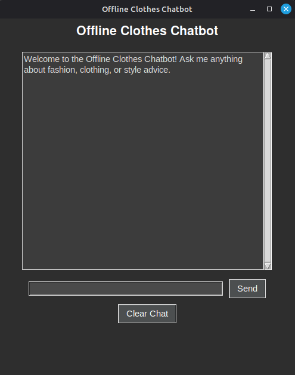
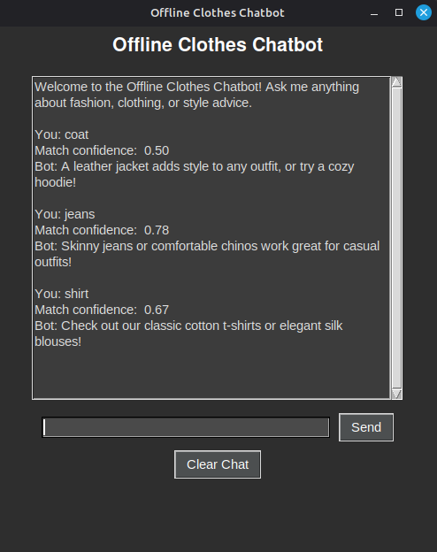

# Offline Clothes Chatbot

A fully offline chatbot that answers questions about clothing and fashion, with a simple desktop GUI built in Tkinter. No API keys and no internet connection needed at runtime (after the one-time model download).

## How it works

User input is compared against a bank of predefined question/answer pairs using [sentence-transformers](https://www.sbert.net/) (`all-MiniLM-L6-v2`). Both the user's message and every stored question are converted into sentence embeddings, and cosine similarity finds the closest match. If the best match scores above a confidence threshold (`0.3`), its paired answer is returned; otherwise the bot asks the user to rephrase.

## Examples



## Requirements

- Python 3.9+
- [`sentence-transformers`](https://pypi.org/project/sentence-transformers/)
- `tkinter` (ships with most Python installs; on Debian/Ubuntu-based Linux you may need `sudo apt install python3-tk`)

## Installation

```bash
git clone https://github.com/Gemmiee/chat-bot.git
cd chat-bot
pip install sentence-transformers
```

## Usage

```bash
python ChatBot_OFFLINE.py
```

Type a question about clothes, fashion, sizing, care instructions, shopping, or style, then press **Enter**. The chat log shows the bot's match confidence alongside its reply.

> **Note:** the first run downloads the `all-MiniLM-L6-v2` model (~80MB) from Hugging Face, which requires an internet connection once. After that, the model is cached locally and the chatbot runs fully offline.

